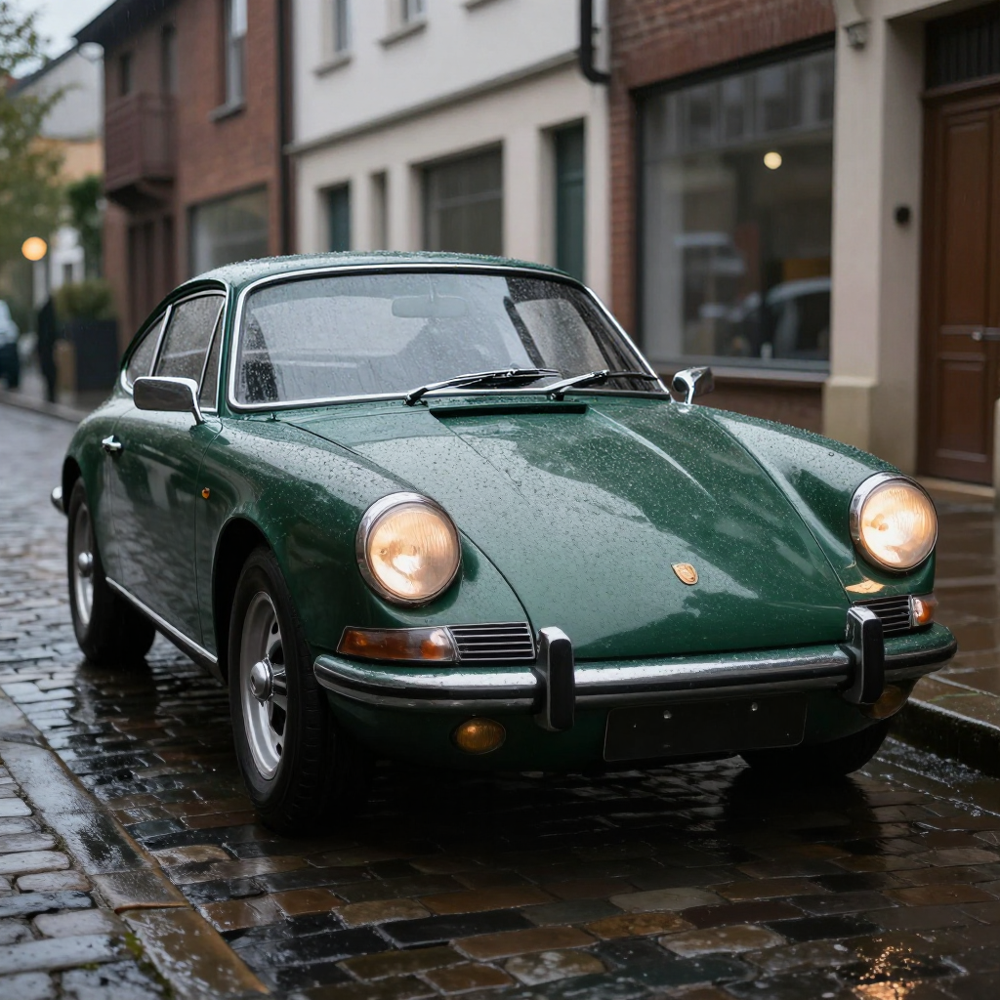
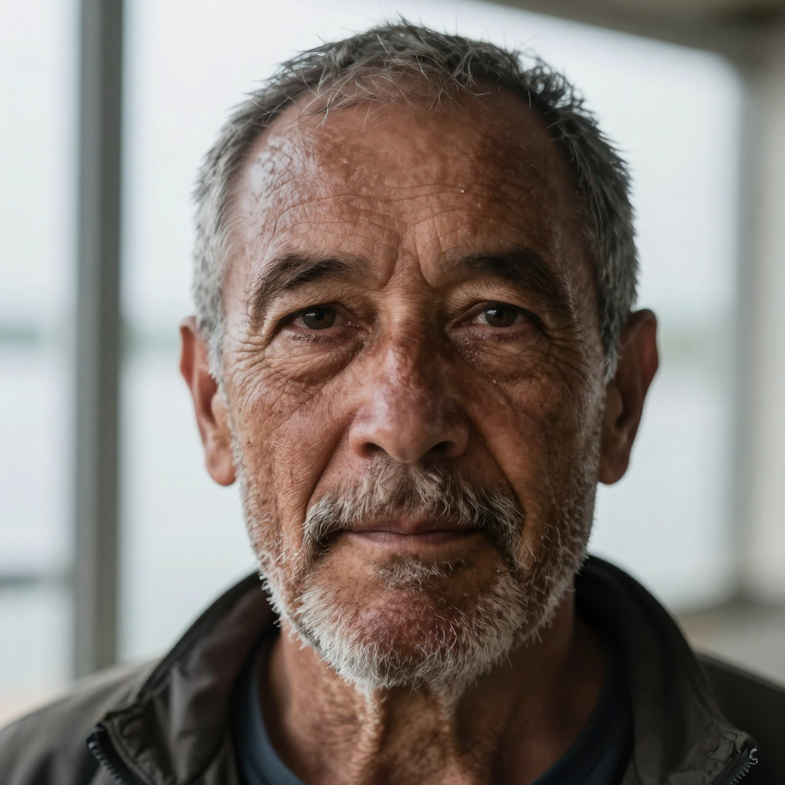

# Remote Qwen3-4B text encoder

Runs the Qwen3-4B text encoder for Z-Image-Turbo and FLUX.2-klein-4B on a separate CPU
machine and serves prompt embeddings over HTTP. The GPU machine only loads the DiT and VAE
and passes the result as `prompt_embeds`.

Qwen3-4B is ~8 GB in bf16 and ~2.5 GB in 4-bit. Moving it off the GPU device frees that
memory for the diffusion model.

```
GPU machine                                  CPU machine
  DiT + VAE                                    Qwen3-4B (bf16 weights)
  prompt  ──── POST /v1/encode ─────────────►  encode, LRU cache
          ◄─── safetensors (bf16 tensor) ────
  pipe(prompt_embeds=...)
```

No weights in this repo.

| file | |
|---|---|
| `encode-server.py` | encoder service |
| `imgenc.service` | systemd unit |
| `client_example.py` | diffusers client for both models |

## Both models, one encoder

Z-Image-Turbo and FLUX.2-klein-4B ship identical Qwen3-4B weights, tokenizer and chat
template. Only the output differs, selected with `mode`:

| mode | thinking | tokens | output |
|---|---|---|---|
| `zimage` | on | real tokens only | `hidden_states[-2]`, (n, 2560) |
| `klein` | off | padded to 512 | `hidden_states[9, 18, 27]` stacked, (512, 7680) |

klein has no text mask, so the pad positions affect the image. Keep all 512.

## CPU: bf16 weights, fp32 compute

On CPUs without native bf16 (no AVX-512-BF16 / AMX), bf16 matmuls are emulated and slow.
The server keeps the weights in bf16 (memory-mapped) and upcasts each Linear's weight to fp32
at matmul time. Norms and the residual stream run in fp32.

Tested CPU: i7-13620H (AVX2, no native bf16), 6 threads.

| | Z-Image, 61 tokens | klein, 512 tokens | rel. L2 vs bf16 | RAM |
|---|---|---|---|---|
| bf16 | 4.95 s | 45-46 s | - | 7.9 GB |
| **bf16 weights, fp32 compute** | **1.63 s** | **9.1-9.3 s** | 0.014-0.021 | 8.0 GB |
| int8 dynamic | 0.48 s | 4.6-4.8 s | 0.55-0.65 | 5.9-7.1 GB |

int8 dynamic quantization is not used: per-tensor activation quantization breaks on Qwen3's
outlier channels.

Short Z-Image prompts (~20 tokens) take ~1.2 s. Repeat prompts are served from cache.
Response size: a few hundred KB for Z-Image, 7.5 MB for klein.

## Tested setup

- GPU side: Jetson Orin Nano 8GB, JetPack 7.2, torch 2.12.1+cu132, diffusers 0.39
- CPU side: i7-13620H, torch 2.14.1+cpu, transformers 5.19

| model on the GPU side | 1024px | system RAM free (min) |
|---|---|---|
| [Z-Image-Turbo bnb-4bit](https://huggingface.co/unsloth/Z-Image-Turbo-unsloth-bnb-4bit), 9 steps | ~75 s | 1.4 GB |
| [FLUX.2-klein-4B NF4](https://huggingface.co/cukrus/FLUX.2-klein-4B-bnb-nf4), 4 steps, edit | ~45-58 s | 1.85 GB |

## Examples

Z-Image-Turbo bnb-4bit on a Jetson Orin Nano 8GB, embeddings from this server. 1024x1024,
9 steps, seed 7000.

| | |
|---|---|
|  |  |
| a wide mountain lake at sunrise, mist drifting over still water, dense pine forest along the far shore, snow-capped peaks behind, clean reflections, photorealistic landscape photography | a dark green vintage sports car parked on a wet cobblestone street at dusk, front three-quarter view, round chrome headlights lit, rain beading on the paintwork, photorealistic |
|  |  |
| a red fox standing in fresh snow at golden hour, sharp amber eyes looking directly at the camera, detailed winter fur, shallow depth of field, wildlife photography | close-up portrait of an older fisherman with a weathered face and grey stubble, looking directly at the camera, soft overcast window light, sharp catchlights in the eyes, 85mm photograph |

## Setup

CPU machine:

```bash
python -m venv venv
venv/bin/pip install torch --index-url https://download.pytorch.org/whl/cpu
venv/bin/pip install transformers safetensors
# text_encoder/ and tokenizer/ from Tongyi-MAI/Z-Image-Turbo or black-forest-labs/FLUX.2-klein-4B
venv/bin/python encode-server.py --model /path/to/model --threads 6
curl -s localhost:8090/health
```

GPU machine: load the pipeline with `text_encoder=None, tokenizer=None` and pass
`prompt_embeds`. Z-Image takes a list of (n, 2560) tensors, klein takes (1, 512, 7680).
See `client_example.py`.

```bash
ENCODER_URL=http://<cpu-host>:8090/v1/encode python client_example.py zimage "a red fox in snow"
ENCODER_URL=http://<cpu-host>:8090/v1/encode python client_example.py klein "make the car red" --image car.png
```

## API

```
POST /v1/encode  {"prompt": "...", "mode": "zimage" | "klein"}
  -> safetensors, one bf16 tensor "prompt_embeds"
     headers: X-Encode-Seconds, X-Tokens, X-Cache (hit|miss)
GET  /health
```

No auth. LAN only.
