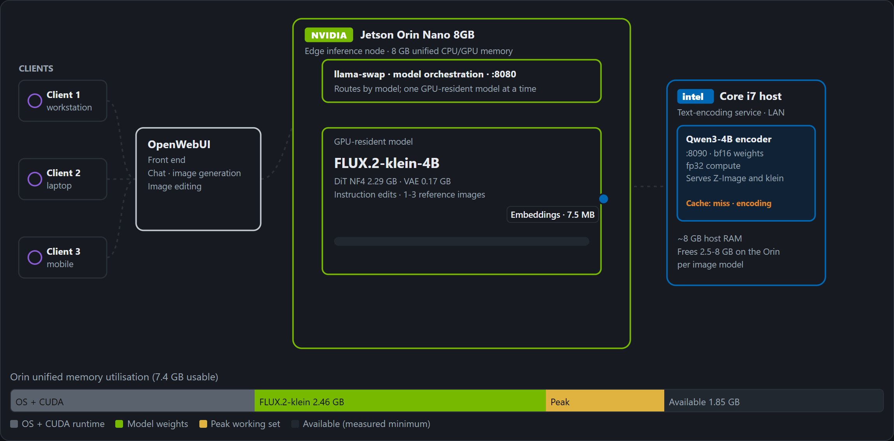

# Remote Qwen3-4B text encoder

Before Z-Image-Turbo or FLUX.2-klein-4B can draw anything, a language model (Qwen3-4B) has to
turn your prompt into numbers the image model understands. That step eats a lot of memory.

This server runs it on another computer's CPU and sends the result back over the network. The
GPU machine only loads the image model.

Qwen3-4B needs ~8 GB at full precision, or ~2.5 GB squeezed down to 4-bit. Moving it off the GPU
gives all of that back to the image model.

```
GPU machine                                  CPU machine
  image model                                  Qwen3-4B
  prompt  ──── POST /v1/encode ─────────────►  encode (cached)
          ◄─── prompt embeddings ────────────
  pipe(prompt_embeds=...)
```

No weights in this repo.

| file | |
|---|---|
| `encode-server.py` | the server |
| `imgenc.service` | runs it as a Linux service |
| `client_example.py` | how to use it from diffusers, both models |

## How it fits together

**Built for an 8 GB Jetson.** The Orin Nano can't hold Qwen3-4B next to an image model, so the
encoder runs on a separate CPU machine.



A klein edit in progress. The Orin sends the prompt to the encoder on the Intel host and gets
7.5 MB of embeddings back. With the encoder off the Orin, klein has 1.85 GB of memory to spare.

- [OpenWebUI](https://github.com/open-webui/open-webui) takes chat, image and edit requests from clients on the LAN.
- [llama-swap](https://github.com/mostlygeek/llama-swap) on the Orin keeps one model on the GPU at a time.
- Z-Image-Turbo and FLUX.2-klein-4B get their `prompt_embeds` from this server.
- SANA-Sprint uses Gemma-2-2B and encodes on the Orin.

[Orin Image Flow](https://huggingface.co/spaces/cukrus/orin-image-flow) animates every request path
with measured timings and memory. Source: [orin-image-flow](https://github.com/Cukrus-directive/orin-image-flow).

## One encoder, two models

Both image models ship the exact same Qwen3-4B, so one server covers both. They want the result
in a different shape, so you pick one with `mode`:

| mode | what you get back | shape |
|---|---|---|
| `zimage` | one row per word-piece of your prompt | (n, 2560) |
| `klein` | always 512 rows, padded, from three layers of the model | (512, 7680) |

klein also reads the padding, so trimming it changes the picture. Always send all 512.

## Why it's fast on a normal CPU

The model files are stored in bf16, a compact number format. Most laptop and desktop CPUs can't
do bf16 math directly, so running the model as-is is slow.

**The trick:** keep the weights in bf16 so they stay small in RAM, and convert each layer to
fp32 right before it's used. fp32 is what these CPUs are good at. Same memory, 3-5x faster,
practically the same output.

Tested on an i7-13620H laptop CPU, 6 threads:

| | Z-Image, 61 tokens | klein, 512 tokens | difference from plain bf16 | RAM |
|---|---|---|---|---|
| plain bf16 | 4.95 s | 45-46 s | - | 7.9 GB |
| **this server** | **1.63 s** | **9.1-9.3 s** | 1.4-2.1% | 8.0 GB |
| int8 | 0.48 s | 4.6-4.8 s | 55-65% | 5.9-7.1 GB |

int8 is faster but changes the output far too much. Qwen3 has a few unusually large values that
int8 can't store accurately.

Short Z-Image prompts take ~1.2 s. Send the same prompt again and it comes straight from the
cache. Each response is a few hundred KB for Z-Image and 7.5 MB for klein.

## Tested setup

- GPU side: Jetson Orin Nano 8GB, JetPack 7.2, torch 2.12.1+cu132, diffusers 0.39
- CPU side: i7-13620H, torch 2.14.1+cpu, transformers 5.19

| model on the GPU side | 1024px | lowest free memory |
|---|---|---|
| [Z-Image-Turbo bnb-4bit](https://huggingface.co/unsloth/Z-Image-Turbo-unsloth-bnb-4bit), 9 steps | ~75 s | 1.4 GB |
| [FLUX.2-klein-4B NF4](https://huggingface.co/cukrus/FLUX.2-klein-4B-bnb-nf4), 4 steps, edit | ~45-58 s | 1.85 GB |

## Examples

Z-Image-Turbo bnb-4bit on a Jetson Orin Nano 8GB, embeddings from this server. 1024x1024,
9 steps, seed 7000.

| | |
|---|---|
|  |  |
| a wide mountain lake at sunrise, mist drifting over still water, dense pine forest along the far shore, snow-capped peaks behind, clean reflections, photorealistic landscape photography | a dark green vintage sports car parked on a wet cobblestone street at dusk, front three-quarter view, round chrome headlights lit, rain beading on the paintwork, photorealistic |
|  |  |
| a red fox standing in fresh snow at golden hour, sharp amber eyes looking directly at the camera, detailed winter fur, shallow depth of field, wildlife photography | close-up portrait of an older fisherman with a weathered face and grey stubble, looking directly at the camera, soft overcast window light, sharp catchlights in the eyes, 85mm photograph |

## Setup

CPU machine:

```bash
python -m venv venv
venv/bin/pip install torch --index-url https://download.pytorch.org/whl/cpu
venv/bin/pip install transformers safetensors
# text_encoder/ and tokenizer/ from Tongyi-MAI/Z-Image-Turbo or black-forest-labs/FLUX.2-klein-4B
venv/bin/python encode-server.py --model /path/to/model --threads 6
curl -s localhost:8090/health
```

GPU machine: load the pipeline without its own text encoder (`text_encoder=None, tokenizer=None`)
and pass the server's output as `prompt_embeds`. `client_example.py` does this for both models.

```bash
ENCODER_URL=http://<cpu-host>:8090/v1/encode python client_example.py zimage "a red fox in snow"
ENCODER_URL=http://<cpu-host>:8090/v1/encode python client_example.py klein "make the car red" --image car.png
```

## API

```
POST /v1/encode  {"prompt": "...", "mode": "zimage" | "klein"}
  -> safetensors, one bf16 tensor "prompt_embeds"
     headers: X-Encode-Seconds, X-Tokens, X-Cache (hit|miss)
GET  /health
```

No auth. Keep it on your local network.
